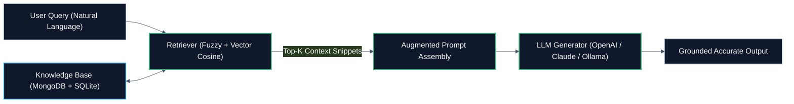
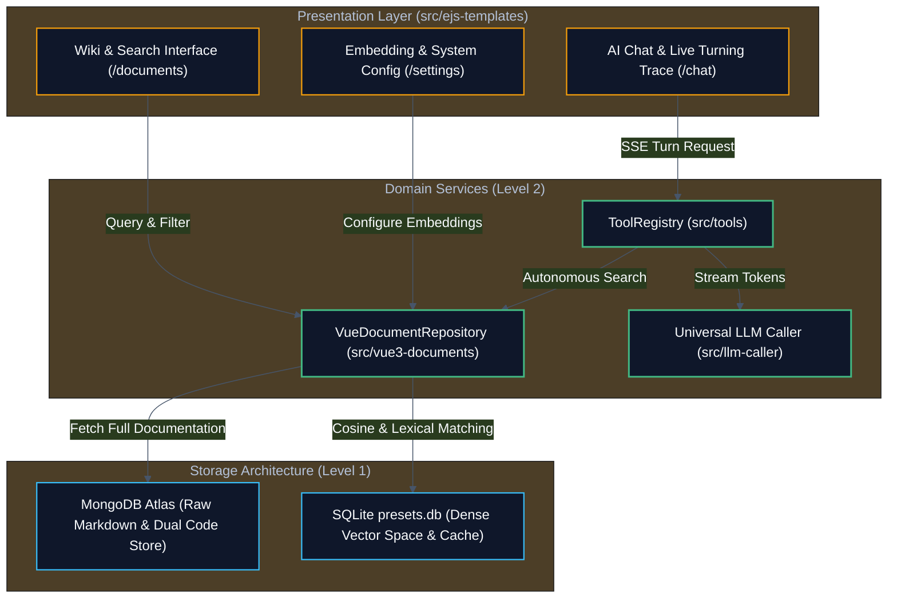
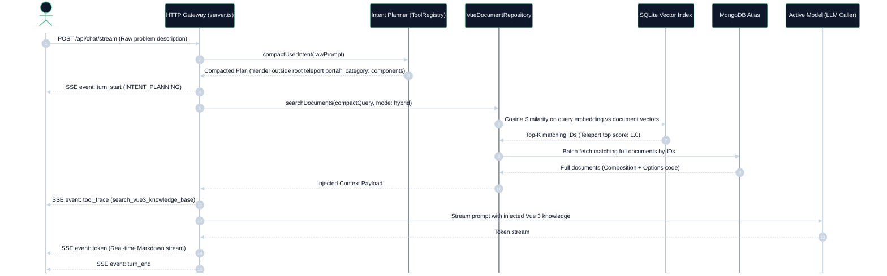
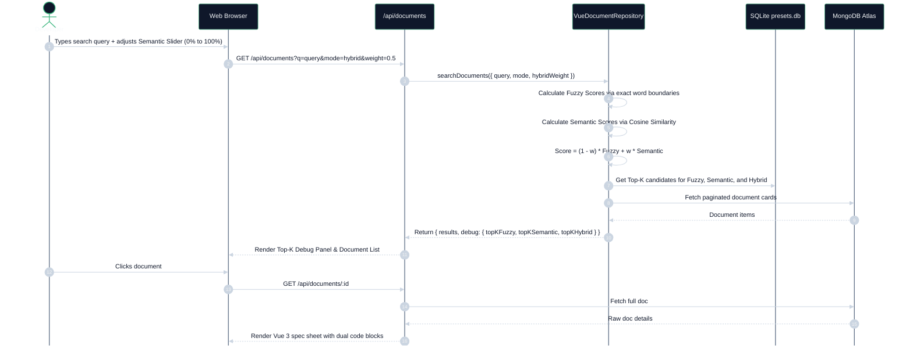

# vue3-rag

A high-performance Vue 3.5 Documentation Retrieval-Augmented Generation (RAG) educational system and playground with hybrid lexical/semantic vector search, tiered storage architecture, and autonomous tool-calling AI agent.

**Author:** [phuongp2003](https://github.com/phuongp2003)  
**Live Demo:** [https://vue.fynx.io.vn](https://vue.fynx.io.vn) *(Protected by HTTP Basic Auth &mdash; credentials provided in release notes / private channel)*

---

## 1. Educational Foundations: What is RAG & How LLMs Work?

This project is built as an open demonstration for engineers and learners looking to understand the fundamentals of Modern Machine Learning, Large Language Models (LLM), and Retrieval-Augmented Generation (RAG).

### 1.1 How LLMs Generate Tokens (The Input-Output Context Window)
A Large Language Model (e.g. GPT-4, Claude, LLaMA) does not "think" or "look up facts" like a database. At its mathematical core, an LLM is a next-token probability distribution engine:

$$P(w_{t} \mid w_1, w_2, \dots, w_{t-1})$$

- **Token Context Constraint:** The model predicts the next word/token based exclusively on the tokens currently in its context window.
- **Knowledge Cutoff & Hallucination:** If the context lacks up-to-date facts (such as new Vue 3.5 macros like `useTemplateRef()` or `useId()`), the model calculates plausible-sounding tokens that might be completely fabricated (hallucinations).

### 1.2 What is RAG (Retrieval-Augmented Generation)?
Instead of fine-tuning or re-training an entire model (costly and static), **RAG** bridges the gap by fetching authoritative documents from an external storage layer and injecting them directly into the context window before generation:



### 1.3 From Words to Geometry: What is Vector Embedding & Cosine Similarity?
Computers cannot compute similarity directly on characters. Embeddings map strings of text into a high-dimensional mathematical vector space ($D$-dimensional coordinates):

$$\text{Text} \xrightarrow{\text{Embedding Model}} \vec{V} = [v_1, v_2, \dots, v_D] \in \mathbb{R}^D$$

- **Semantic Closeness:** Synonyms and related concepts point in almost the same geometric direction even if they do not share any words (e.g., *"render outside root"* and *"<Teleport>"*).
- **Cosine Similarity:** The degree of alignment is evaluated by computing the angle $\theta$ between the query vector $\vec{Q}$ and document vector $\vec{D}$:

$$\cos(\theta) = \frac{\vec{Q} \cdot \vec{D}}{\|\vec{Q}\| \|\vec{D}\|} = \frac{\sum_{i=1}^D Q_i D_i}{\sqrt{\sum_{i=1}^D Q_i^2} \sqrt{\sum_{i=1}^D D_i^2}}$$

---

## 2. System Architecture & Module Decomposition



### Module Responsibilities:
- **`src/db/` (Level 1 Infrastructure):** Prisma client singleton connecting to MongoDB Atlas for raw document presentation (`vue_documents`).
- **`src/llm-caller/` (Level 1 Infrastructure):** Pure JavaScript SQLite preset store (`presets.db`) and unified OpenAI/Anthropic protocol caller with SSE streaming.
- **`src/vue3-documents/` (Level 2 Domain):** Implements `VueDocumentRepository`, text embedding extraction, Cosine Similarity, and dual-syntax Vue 3 data representation.
- **`src/tools/` (Level 2 Tool Engine):** Agentic tool registry offering `search_vue3_knowledge_base` and `get_vue3_syntax_comparison` with autonomous intent compacting.
- **`src/ejs-templates/` (Level 1 Presentation):** Clean dark UI views with fixed layouts, real-time Marked.js markdown streaming, and a 75% sliding turning trace panel.

---

## 3. Tiered Storage Strategy (Why MongoDB + SQLite?)

| Storage Engine | Purpose | Data Held | Rationale |
|---|---|---|---|
| **MongoDB Atlas** | **Raw Content & Presentation Store** | Full markdown documentation, Composition API `<script setup>` snippets, Options API snippets, source URLs, timestamps | Scalable document storage that keeps memory light and handles polymorphic schemas easily. |
| **SQLite (`presets.db`)** | **Search Index & Dense Vectors** | Document IDs, Slugs, Titles, Categories, Use-case intents, Dense 3072/56-dim embedding vectors, Providers, Models, Settings | Sub-millisecond Cosine Similarity and lexical ranking calculated locally in-memory without external network latency. |

---

## 4. Sequence Workflows

### Sequence 1: Autonomous Intent Turning & Hybrid RAG Chat
When a user describes an architectural problem in natural language (e.g., *"How do I keep my filter state in component A while rendering the controller onto the global navbar?"*):



---

### Sequence 2: Multi-Mode Search with Top-K Debugging (`/documents`)



---

## 5. Setup & Running

### Prerequisites
- Node.js >= 16.x (v22+ recommended)
- MongoDB instance (Atlas or local)

### Installation
```bash
git clone https://github.com/phuongp2003/vue3-rag.git
cd vue3-rag
npm install
npx prisma generate
```

### Environment Configuration
Copy `.env.example` to `.env` and fill your MongoDB connection string:
```bash
cp .env.example .env
```

### Build & Start
```bash
npm run build
npm start
```
Access the application at `http://localhost:3000`.

- `/documents`: Browse Vue 3 specification wiki, test Fuzzy/Semantic/Hybrid searches, inspect Top-K debug metrics.
- `/chat`: Real-time AI chat with 75% hover turning trace and autonomous RAG tool calls.
- `/providers`: Add/Edit/Delete LLM and embedding providers.
- `/settings`: Choose active embedding model and trigger complete re-indexing.

---

## 6. License

- Documentation content referenced from [vuejs.org](https://vuejs.org) (CC BY 4.0).
- Source code released under [MIT License](https://opensource.org/licenses/MIT) by [@phuongp2003](https://github.com/phuongp2003).
